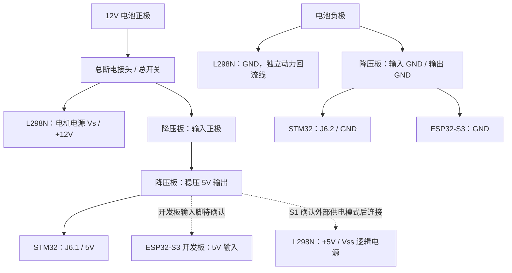
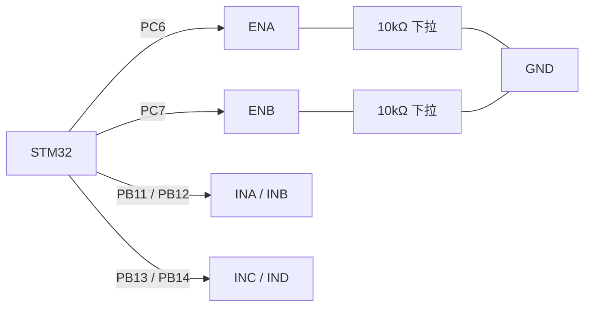

# L298N 升级版模块接线图

2026-10-19：用户决定将 TB6612FNG 换为 L298N，并把方向引脚改为 PB11、PB12、PB13、PB14。本文件为当前驱动接线方案；此前 TB6612 的 VCC=3.3V、PB0/STBY 和 1kΩ 下拉接法不再用于新驱动。

依据：双龙电子《L298N电机驱动模块(升级版)指导手册》V0.2，2012.11.2，第 1–3 页。附件共 9 页，是带模块照片、参数和示例程序的指导手册，没有完整模块电路原理图。照片上的供电选择器为 S1，不能照搬其他红色 L298N 模块的跳帽位置。

**图中电气端子连接已给出；实物的 S1 外部逻辑供电档位、ENA/ENB 固定使能连接仍需核对。** 既有 ESP32-S3 开发板 5V 输入位置和降压板端子映射尚未补齐。此次未刷写、未接电、未执行电机动作；不能将图理解为这些硬件已验证。

## 供电图：电池分路，外部降压板统一供 5V



所有地共地。另保留 STM32 GND 到驱动 GND 的信号地连接；电机电流直接由驱动电源地回电池，不穿过主控排针、面包板或细杜邦线。降压板 3V3 输出留空。STM32 的 3V3 不再给驱动逻辑电源供电。

模块照片标有电机工作电压、GND、+5 三个电源端子。本方案选择外部 5V 给逻辑供电：**必须将 S1 设为断开板内取电、允许外部逻辑供电的状态，再接外部 5V。** 手册未说明按下/弹起分别是什么状态，不凭照片猜。不要把模块内部稳压器输出与外部降压板输出并联；也不从 L298N 的板载 5V 给主控供电。若手头实物是另一种有 5V-EN 跳帽的板，需按其电路核对，不能把 S1 的说明直接套上去。

降压板红色开关只切断降压板支路，不能切断外部分路的 L298N Vs。整车断电使用分路前的总接头/总开关。电池标签充电目标为 12.6V，仍称“12V 电池”；它并非恒定 12.0V 电源。

## 控制线：PWM 保留，方向改为 PB11–PB14

**版本切换：本表需要 PB11–PB14 新固件；板上最后已知固件仍为 PB12–PB15，本次未烧录。不能只改接线后通电运行，需在动力断开时配套切换。**

J2.45/46 与 J2.47/48 为相邻两对，四针呈 2×2 排列。PB11 在所附板图中直接引出，当前固件没有其他用途；PB12–PB14 还引到 TFT 触摸接口，本方案不安装该扩展外设。PB15 不再接驱动。

| STM32 信号 | F4VE 排针编号 | L298N 对应端子 |
|---|---|---|
| PC6 | J3.39 | ENA，左轮 PWM |
| PB11 | J2.45 | INA / IN1，左轮方向 1 |
| PB12 | J2.46 | INB / IN2，左轮方向 2 |
| PC7 | J3.38 | ENB，右轮 PWM |
| PB13 | J2.47 | INC / IN3，右轮方向 1 |
| PB14 | J2.48 | IND / IN4，右轮方向 2 |
| GND | 例如 J2.9 | GND，信号共地 |

手册照片的方向输入丝印为 INA/INB/INC/IND，直流电机示例使用 IN1/IN2 名称；本表列出对应叫法。按端子功能与丝印接，不按接插件左右位置猜测。J2/J3 是 STM32 开发板连接器编号，不是芯片引脚号。

PB0 不接 L298N；L298N 没有 TB6612 的 STBY 接口。原先 PB0 到 STBY 的线撤掉，原 STBY 用的 1kΩ 下拉不再是本方案的一部分。不要把 PB0 接到 +5V、电源选择开关、ENA 或 ENB。

若 ENA/ENB 原来被跳帽或其他连接固定到逻辑高电平，先解除该连接，再接 PC6/PC7。带高电平跳帽的针座应接真正的使能信号针，不能把 PWM 输出接到相邻 +5V 针。建议在驱动端分别加 ENA→10kΩ→GND、ENB→10kΩ→GND 两只下拉电阻，使 MCU 复位/未连接时保持禁用；这以没有未处理的板载上拉为前提，不能用下拉对抗固定 +5V。实际复位低电平需测量验证。

手册规定方向和使能高电平最低 2.3V，因此正常 3.3V GPIO 可直接控制；**控制信号 3.3V 与逻辑电源 5V 是两回事**。



## 电机输出

| L298N 端子（照片 / 通用命名） | 电机 |
|---|---|
| OUTA / OUT1 | 左电机绕组一端 |
| OUTB / OUT2 | 左电机绕组另一端 |
| OUTC / OUT3 | 右电机绕组一端 |
| OUTD / OUT4 | 右电机绕组另一端 |

MG513P30_12V 霍尔款手册的绕组端为针 1 和针 6，必须按厂家接口视角核对；不要凭线色或从任意一端数。可沿用原来接驱动的两根绕组线。电机绕组两端都接桥输出，不能把其中一端固定接电池负极。编码器四线按下一节连接，不使用模块照片中的五针步进电机接口。

## 编码器接线（2026-10-19 新增，固件计数尚未实现）

此前建议编码器四线留空是开环电机试转阶段安排。现按用户询问补齐接线：编码器 A/B 直接接 STM32，编码器电源统一取 STM32 板上 3V3，不接 L298N 的 5V、电机输出或 12V 电池。

以下针号只适用于已确认的 MG513P30_12V **霍尔编码器款**，按厂家产品说明手册第 5 页图 1-1 的电机本体接口观察方向编号。未确认实际线束方向前，不从插头任意一面按左右猜测，也不按颜色推定。GMR 款电源与地针位相反，不能混用。

| 电机 | 编码器接口针号/功能 | STM32 接点 | 计划用途 |
|---|---|---|---|
| 左 | 2，编码器 VCC | 3V3，例如 J2.5 | 3.3V 供电 |
| 左 | 5，编码器 GND | GND，例如 J2.9 | 信号/电源地 |
| 左 | 3，A 相 | PE9，J2.37 | TIM1_CH1，AF1 |
| 左 | 4，B 相 | PE11，J2.39 | TIM1_CH2，AF1 |
| 右 | 2，编码器 VCC | 3V3，例如 J2.6 | 同一 3.3V 母线 |
| 右 | 5，编码器 GND | GND，例如 J2.10 | 公共地 |
| 右 | 3，A 相 | PB6，J3.16 | TIM4_CH1，AF2 |
| 右 | 4，B 相 | PB7，J3.15 | TIM4_CH2，AF2 |

左轮此前仅预留 PA0/PA1，未实现计数、未确认接线；新 F4VE 板图显示 PA0 接 K_UP 按键，按下可连接 3V3。为避免与编码器输出共用按键网络，现改用 PE9/PE11。右轮保留 PB6/PB7。PE9/PE11 还引到 TFT 接口，PB6/PB7 还引到 NRF2401 接口，本项目不安装这些扩展模块。TIM1 只计划配置编码器输入 PE9/PE11，PB13/PB14 继续保持电机方向 GPIO，不切换成 TIM1 互补输出。

两只编码器共享 STM32 的同一 3.3V 电源，不并接降压板独立 3V3 输出。厂家霍尔款供电范围 3.3–5V，选择 3.3V 配合 STM32 输入；实际板载 3.3V 供电压降仍需检查。编码器供电地与电机驱动地共地，但编码器细线不承担电机电流。

```text
左编码器 VCC ── STM32 3V3      右编码器 VCC ── STM32 3V3
左编码器 GND ── STM32 GND      右编码器 GND ── STM32 GND
左编码器 A   ── PE9            右编码器 A   ── PB6
左编码器 B   ── PE11           右编码器 B   ── PB7
```

本次只补齐接线说明，未实现/烧录 TIM1、TIM4 编码器读取，也未验证脉冲。先全部断电接线；后续计数功能完成后，保持电机动力断开，给主控和编码器供电，用手转动轮子检查计数及正负方向，再进入带动力闭环。当前已生成的 PB11–PB14 方向引脚固件不包含编码器计数。无需因为接线完成就接通电机动力。

候选分辨率为 13×30×4=1560 counts/输出轴圈，来自霍尔线数、减速比及四倍频计算，最终需实测确认，不将其当成已标定结果。

## ESP32-S3 与 STM32 的通信保持原接线

| 来源 | 去向 |
|---|---|
| ESP32 GPIO17 / TX | STM32 PA3 / RX，J2.26 |
| STM32 PA2 / TX，J2.25 | ESP32 GPIO18 / RX |
| ESP32 GND | STM32 GND |

UART：115200，8N1。STM32 电源使用 J6.1=5V、J6.2=GND；J6 的 PA9/PA10 不用于这条通信。ESP32 仍为 S3，C3 附件排除；S3 模组规格书并不能唯一确定开发板 5V 排针。模组 3V3 焊盘不能接 5V。

## 固件与停机语义

已检查当前 firmware/stm32/src/main.c：PC6/PC7 输出 10kHz PWM，PB11–PB14 控制方向，motor_off() 将两路比较值置零并用更新事件装载，初始化、方向切换和停机清零均已更新为同一组新引脚常量；PB0 继续被旧固件写入但在本方案中不接外部，不再充当实际使能。

新方向引脚固件尚未烧录，没有完成 L298N 实物验收，不宣称已刷写专用 L298N 固件。原 TB6612 测试记录中的 PB0/STBY 电平不再能证明新驱动禁用；应检查 ENA、ENB 真正低电平。L298N 的 EN 低为自由停止，EN 高且两方向相同为制动；将 PWM 移到 EN 后，PWM 关闭阶段的电机行为与 TB6612 的 PWM 输入不同，原起转占空比和速度响应需要重新测试。轮子正反方向也需重新核对。

## 电流与验证边界

该模块手册把驱动电流标为 2A；电机厂家表列堵转 3.2A。ST 芯片数据手册也将每通道 DC 2A、非重复 100ms 3A 列在绝对最大额定值中，不能据此认定模块可持续满载或安全堵转。L298 在 1A 下总压降上限为 3.2V、2A 下为 4.9V（规定测试条件）；电机实际电压低于电池，功率损失会转成发热。不要用提高电池电压的方式补偿。

因此此更换不是提高堵转电流余量；初次只能在供电和禁用检查通过后安排架空、短时、逐轮试转，评估电流和温升，再决定实际负载适用性。不安排人为堵转测试。

接线前电池和电脑 USB 全部断开。先核实 S1、使能连接与 5V 输出，再做无电机动力的逻辑供电/复位/STOP 检查；逻辑检查通过后另行接电机动力。带电池运行时，STM32、ESP32 与 ST-Link 通往电脑的 USB 都断开。此次仅修改、构建固件与文档，不烧录、不执行任何电机动作。

## 来源

验证记录（方向脚调整后）：stm32-motion 构建成功，check_stm32_artifact.py 检查通过，6 项 test_motion.py 测试通过。BIN 为 10008 bytes，SHA256：`3a26e73241fc58671e4d295ce77f6cc6a3604c504f919649d35ee7d3c7bcf036`。测试不替代 GPIO 实测；未烧录、未驱动电机。

- 用户附件：C:/Users/imxiaocai/Desktop/gc/资料/L298N电机驱动模块(升级版)指导手册.pdf，第 1–3 页。
- [ST L298 数据手册](https://www.st.com/resource/en/datasheet/l298.pdf)，DS0218 Rev 5，第 3–6 页。
- 用户此前提供的 STM32 F4VE 核心板原理图、多路电源原理图、MG513P30_12V 电机资料，以及项目现有固件。
