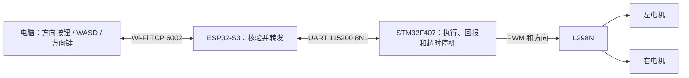

# 电脑控制小车：ESP32 v3 与通信约定

2026-10-22。代码和烧录文件已准备；本次未刷写或驱动实物电机。

## 链路与职责



- 电脑负责人的输入和每 50ms 一次的运行指令；连接与使能分开。
- ESP32 负责热点、TCP、帧解析、会话与参数检查。只转发 STM32 真实回包，不生成“已运动”或“已停车”的成功回执，也不自行生成运动心跳。
- STM32 负责 PWM/方向输出、斜坡和本地 300ms 指令超时保护。编码器采集和速度闭环暂未实现，回报的是占空比，不是转速或行驶距离。

## 操作及方向约定

双击 `pc/control_car.cmd`。电脑先连接 `ChassisDrive-Setup`，密码 `Chassis2026`；目标 `192.168.4.1:6002`。控制本身不需要互联网。连接按钮只执行握手，随后需点击“使能控制”。

默认目标为 100 千分比，即 10% 占空比。正数定义为该侧车轮向车头方向滚动；第一次必须架空逐轮核对物理轮向。若某侧反向，应断电后对调该电机两根动力线，编码器线不跟着对调。表格中的“正/负”是软件约定，不代表尚未验收的实际轮向。

| 操作 | 按键 | 左目标 | 右目标 |
|---|---|---:|---:|
| 前进 | W / ↑ | +100 | +100 |
| 后退 | S / ↓ | -100 | -100 |
| 原地左转 | A / ← | -100 | +100 |
| 原地右转 | D / → | +100 | -100 |
| 松开方向 | 释放按钮或按键 | 0 | 0 |
| 停车并禁用 | 红色按钮 / 空格 / Esc | 撤销输出 | 撤销输出 |

鼠标必须按住方向按钮；移出按钮或松开后清除该方向。键盘与鼠标方向可组合；同时按前/后或左/右时目标归零。窗口失焦、退出或 UI 心跳超过 200ms 未更新会撤销运行意图并请求禁用；失败时不会显示已停车。停车后须手动重新使能。释放方向时 STM32 按斜坡将输出降为零，STOP 则立即撤销 PWM；两者均不是物理停稳时间保证。

如不用快捷启动，可在仓库根目录运行：

```powershell
& .\.venv\Scripts\python.exe pc/drive.py --host 192.168.4.1 --allow-hardware --allow-motion --keyboard --duty 100
```

电脑端只依赖 Python 标准库与 tkinter，无需安装额外控制软件。快捷启动在仓库中优先使用 `.venv`，独立复制后使用 Windows 的 `py -3` 或 PATH 中的 `python`。

## 电脑与 STM32 使用同一协议

Wi-Fi 是 TCP 字节流，UART 也是字节流；一帧可以分多次收到，也可能连在一起。不能按每次 `read` 的长度或换行符分包。

电脑→ESP32→STM32：固定 32 字节，帧头 `DCM2`；STM32→ESP32→电脑：固定 40 字节，帧头 `DCS2`。所有多字节字段采用小端，CRC32/ISO-HDLC 覆盖 CRC 字段前全部字节。具体偏移表见 [MOTION_PROTOCOL.md](MOTION_PROTOCOL.md)。继续使用 v2 线协议与 STM32 协议标识 `0x20261011`；ESP32 本次版本为 v3/20261022，不能拿 ESP32 版本号替换 STM32 回包字段。

| 指令 | 编号 | 约定 |
|---|---:|---|
| HELLO | 1 | 电脑随机非零 session，token=0；STM32 先禁用输出，再返回新 token |
| ARM | 2 | 带当前 session/token，左右目标=0；STM32 确认后才可发运动指令 |
| DRIVE | 3 | 带递增 sequence、当前 session/token、左右有符号占空比 |
| STOP | 4 | 立即撤销输出和 token；即使旧会话失效也能请求停车 |
| STATUS | 5 | 读取 STM32 状态，不给运动指令续期 |

占空比范围 `-250..250`（±25%），不是 rpm。正负号表示方向。序号使用 32 位回绕比较；重复和旧序号不续期。每次只允许一个待确认请求，必须等 STM32 回包后才发下一条，不能流水线堆积运动指令。原 TCP 6001 保留 PING/STOP 诊断，两端口合计仅允许一个活动控制连接。

电脑控制循环：

1. 连接 TCP → HELLO → 确认禁用状态。
2. 人点击使能 → 新 HELLO → ARM → 确认使能。
3. 每 50ms 发送 DRIVE；无方向输入时仍发 DRIVE(0,0)，保持可控的零目标状态。
4. 人停车或窗口失焦 → STOP → 确认撤销输出；重新握手后保持禁用。
5. 超时、断线、STM32 复位、错误回复或拒绝结果 → 结束当前连接，不自动重连/恢复运动。

回包包含请求序号、session、STM32 uptime、协议标识、flags、token、左右当前斜坡输出和 result。PC 显示“STM32 回报占空比”，不把发送值当作已经执行的值。

超时设置：ESP32 等运动回复 150ms，电脑等回复 200ms；残帧 100ms、无有效 PC 请求 1000ms 时 ESP32 断开并尝试发送 STOP。即使 STOP 丢失或 ESP32 卡住，STM32 自己在最后有效 ARM/DRIVE 后 300ms 撤销使能；STATUS、坏帧、旧序号不续期。这些是代码阈值，网络、机械停车时间尚未实测。

## 接线

| ESP32-S3 | STM32F407VET6 |
|---|---|
| GPIO17 / UART TX | PA3 / USART2 RX（J2.26） |
| GPIO18 / UART RX | PA2 / USART2 TX（J2.25） |
| GND | GND |

串口 `115200、8 数据位、无校验、1 停止位`，使用板间 3.3V TTL 信号，TX/RX 交叉连接。两板各自供电时仍需共地。数据 UART 与 USB 日志分开。

STM32→L298N：PC6→ENA，PC7→ENB，PB11/12/13/14→IN1/2/3/4，GND 共地，PB0 不接驱动。完整供电及编码器针号见 [L298N_WIRING_2026-10-19.md](L298N_WIRING_2026-10-19.md)。

## 构建和烧录

ESP32 目标为 S3 N16R8（16MB Flash / 8MB PSRAM），PlatformIO 环境 `esp32-s3-bridge`：

```powershell
& .\.venv\Scripts\python.exe -m platformio run -d firmware/esp32
```

确认实际串口后，在 12V 断开时上传（COMx 必须换为实际端口）：

```powershell
& .\.venv\Scripts\python.exe -m platformio run -d firmware/esp32 -t upload --upload-port COMx
```

`firmware.bin` 是应用镜像，地址为 `0x10000`，不能从地址零单独写入。PlatformIO 会配套上传 bootloader、分区和 OTA 初始化数据；如果用合并镜像，必须使用此次另行生成并检查的完整镜像，地址 `0x0`。

STM32 使用此前已准备的 PB11–PB14 版 `stm32-motion` 固件，本次无需修改其通信格式。该版本仍未确认烧录成功：前次读到 Level 1 读保护，解除会擦除主 Flash 与备份 SRAM，相关操作尚未获准。不能仅刷 ESP32 后就宣称新引脚接线可带动力运行。

上板顺序：两板配套固件 → 保持 12V 断开，核对 HELLO/STOP 与默认输出 → 接好独立逻辑供电并核对电压 → 架空逐轮短时确认轮向 → 验收停车/失联 → 最后落地。当前没有执行这些新的硬件验收。

## 本次软件验证

- 35 项测试通过；新增测试运行固件实际 C 网关与 STM32 控制核心，经本机 TCP 接入真实 Python 客户端，验证四个方向和 STOP、禁止握手前使能、会话/序号检查、回复超时、时间回绕和复位检测。
- ESP32 v3 编译成功：静态 RAM 45280 bytes，Flash 报告 725317 bytes，应用 BIN 725680 bytes；esptool 镜像 checksum 与 hash 均有效。
- 电脑窗口离线启动检查通过：7 个按钮、初始使能禁用，内容适配 640×500 窗口；未连接硬件。
- STM32 运动/诊断双构建通过；本轮未修改 STM32 主程序或上传任何板卡。
- 最后一次本机串口枚举为空，没有可供 ESP32 上传的 COM 口。重新接入后需重新检测，不能沿用历史 COM8。
- 软件测试用模拟传输，不包含真实 Wi-Fi/串口时序、GPIO 电平、电机轮向或物理停车验证。

## 交付文件

当前电脑交付目录：`C:\Users\imxiaocai\Documents\Codex\2026-10-10\chassis-drive-handoff\outputs\esp32-control-2026-10-22`。

- `esp32-main.cpp`：ESP32 主程序，编译还需要源码包内的 common 库和 PlatformIO 配置。
- `chassis-control-v3-source.zip`：两板、电脑端、公共协议、测试和说明的配套源码。
- `open_control.cmd`：本电脑快捷入口，使用现有项目的 Python 环境运行交付目录的电脑客户端；只打开窗口，不自动连接或使能。
- `flash/esp32-s3-control-v3-full-0x0.bin`：完整合并镜像，791216 bytes，写入地址 `0x0`。四个输入镜像区域均逐字节核对；保留构建生成的 16MB/80MHz/DIO 引导头。
- `flash/firmware.bin`：仅应用，725680 bytes，写入地址 `0x10000`。
- `manifest.json`：各文件字节数与 SHA256、构建和未烧录状态；`IMAGE_CHECK.txt` 保存镜像检查结果。

应用 BIN SHA256：`20a30ce61721b4f2dfa9ec2fc9744e9e0d10c52e35eb2ba735f751294abb711e`。

完整合并 BIN SHA256：`21ff783c98651deb89bc5eff193e7b1ee2f4232f5d5ef0fe7d3048d42a4bcbaf`。
