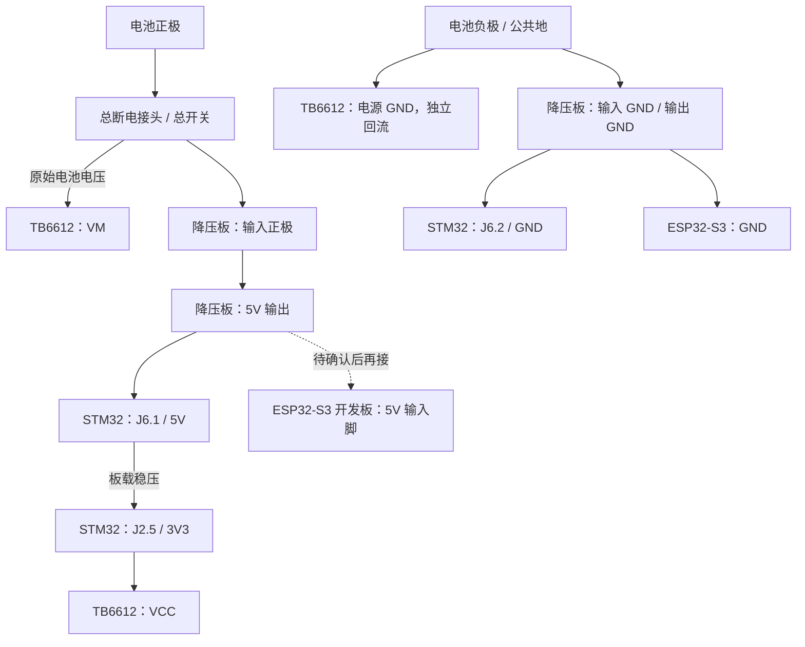
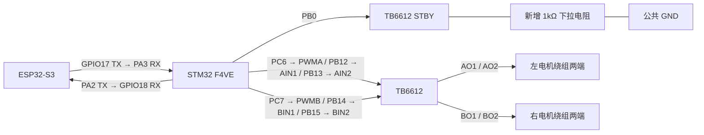

# 共用电池、引脚供电接线方案

> 已被后续驱动选择取代：用户同日决定改用 L298N，当前接线见 `L298N_WIRING_2026-10-19.md`。本文件保留为 TB6612 历史方案。尤其不要把下面的 3V3→VCC、PB0→STBY 和 STBY 1kΩ 下拉用于 L298N。

日期：2026-10-19。适用：STM32F407VET6 开发板、ESP32-S3 N16R8 开发板、独立 TB6612FNG、两台 MG513P30_12V、WHEELTEC E326S 电池，以及用户提供的多路降压板。

**当前状态：STM32 引脚供电已由新提供的 F4VE 核心板原理图确认；ESP32-S3 开发板的 5V 输入脚和降压板实物端子位置仍待确认。** 用户确认 C3 资料是误传，排除使用。S3 附件是 WROOM-1 模组规格书，不能据此认定开发板 5V/VIN 排针。商品图与降压原理图的连接器布局不完全一致，不能凭颜色或照片左右位置指定接线孔。本次仅审查资料，没有重新烧录、改变硬件连接或运行电机。

**本次新增修正：PB0/STBY 对地加 1kΩ 下拉电阻。** F4VE 原理图显示 PB0 同时接板载 W25Q16 的 F_CS，R20=10kΩ 上拉至 3V3。此前只考虑 TB6612 内部下拉，不能确保 MCU 复位期间 STBY 为低。此方案保留现有固件与 PB0 接线，用新增下拉处理该板卡上拉，详见下文。

## 供电结构

一块电池供整车，正极在降压板外分路。使用分路前可拔下的电池接头作为总断电点；若安装总开关，其额定电流应覆盖整车负载。



下图补充控制信号；同名端子是同一个电气节点。电机编码器线本阶段留空。



```text
电池正极 ── 总断电接头/合适的总开关 ──┬── TB6612 VM
                                     └── 降压板输入正极
                                              │
                                         稳压 5V 输出
                                              ├── STM32 J6.1（5V）
                                              └── ESP32-S3 5V 输入脚（待确认，暂不接）

电池负极 ──┬── TB6612 电源 GND（独立动力回流线）
           └── 降压板输入 GND
                 ├── 输出 GND → STM32 J6.2（GND）
                 └── 输出 GND → ESP32 GND

STM32 J2.5（3V3） ── TB6612 VCC
STM32 J2.9（GND） ── TB6612 信号 GND
STM32 PB0 ── TB6612 STBY ── 1kΩ 电阻 ── GND
```

所有 GND 电气相通；两块开发板各自从同一个 5V 输出母线取电。电机电流直接经 TB6612 电源地回电池，不经过 MCU 排针或细杜邦信号线。动力支路采用能承受电机电流的导线和接头，不用面包板承载。

**上述接法中，降压板红色开关只切断降压板支路，不能切断 TB6612 的 VM。整车断电必须断开分路前的电池接头/总开关。** 原理图没有明确引出受板载开关控制的 VM 输出端子，不能猜测绿色端子就是该输出。

## 逐线供电表

| 起点 | 终点 | 确认要求 |
|---|---|---|
| 电池正极，经总断电点 | 降压板输入正极 IN+ | 原理图为 M1 的 1 脚，实物接线孔待定位 |
| 电池负极 | 降压板输入负极 IN−/GND | 原理图为 M1 的 2 脚，实物接线孔待定位 |
| 电池正极，经同一总断电点 | TB6612 VM | 原始电池电压，不接降压板 5V |
| 电池负极 | TB6612 电源 GND | 独立动力回流连接 |
| 降压板 5V 输出 | STM32 J6 的 1 脚（5V） | 原理图已确认，J6 为四针 ISP_COM 接口 |
| 降压板输出 GND | STM32 J6 的 2 脚（GND） | 与 5V 配对布线 |
| 降压板同一路 5V 输出 | ESP32 开发板的 5V 电源输入脚 | 具体 5V/VIN 丝印与输入能力待板卡资料确认 |
| 降压板输出 GND | ESP32 GND | 与 5V 配对布线 |
| STM32 J2 的 5 脚（3V3） | TB6612 VCC | 保持已有逻辑供电接法，VCC 不接 12V，也不改接 5V |
| STM32 J2 的 9 脚（GND） | TB6612 GND | 保留信号共地线 |

降压板 3V3 输出本方案留空。不要把它并接到 STM32 或 ESP32 的 3V3 输出，也不要把两块开发板的 3V3 输出并接。不要将电池 12V 直接接入两块开发板的 5V、3V3 或未经确认的 VIN。

## STM32 → TB6612 控制线

沿用已烧录固件和已接好的逻辑线，不需要因更换供电方式修改固件。

| STM32（排针编号） | TB6612 | 用途 |
|---|---|---|
| PC6（J3.39） | PWMA | 左轮 PWM |
| PB12（J2.46） | AIN1 | 左轮方向 1 |
| PB13（J2.47） | AIN2 | 左轮方向 2 |
| PC7（J3.38） | PWMB | 右轮 PWM |
| PB14（J2.48） | BIN1 | 右轮方向 1 |
| PB15（J3.48） | BIN2 | 右轮方向 2 |
| PB0（J2.33） | STBY | 使能；另外从 STBY 接 1kΩ 下拉电阻到 GND |

1kΩ 电阻跨接在 STBY 与 GND 之间，**不串入 PB0 到 STBY 的信号线**。采用常见 1kΩ、1/4W 电阻即可。按图中 10kΩ 上拉计算，复位时分压约 3.3×1/(10+1)=0.30V（忽略 TB6612 内部下拉时的上界），软件驱动高电平时电阻电流约 3.3mA。此前建议的 10kΩ 下拉与板载 10kΩ 上拉分压接近 1.65V，不能作为此板默认禁用的可靠方案。该计算基于所附板图，不包括未知的 TB 模块额外上拉；模块不能将 STBY 固定接高。

当前固件没有使用板载 W25Q16；PB0 用作 STBY 时，不同时运行外部 Flash 的 SPI 驱动。PB12–PB15 还连接 TFT 触摸接口，本接线方案不安装该扩展外设。STM32 内部程序 Flash 不受这个外部 Flash 片选复用影响。

## ESP32 ↔ STM32 通信线

| 起点 | 终点 |
|---|---|
| ESP32 GPIO17，TX | STM32 PA3（J2.26），RX |
| STM32 PA2（J2.25），TX | ESP32 GPIO18，RX |
| ESP32 GND | STM32 GND |

UART：115200、8N1。原有共地连接保留。

## TB6612 → 两台电机

| TB6612 输出 | 电机 |
|---|---|
| AO1 / AO2 | 左电机绕组的两根线 |
| BO1 / BO2 | 右电机绕组的两根线 |

此前厂家霍尔款接口图：针 1 为电机负、针 6 为电机正，针 2/3/4/5 分别为编码器电源/A/B/地。必须以厂家接口观察方向核对编号，不能由线色猜测。暂定 AO1/BO1 对应各自针 6，AO2/BO2 对应各自针 1；实际安装的前进方向待架空逐轮测试。

本阶段四根编码器线分别绝缘留空，固件尚未实现编码器闭环。电机绕组两端都接驱动输出，不把其中一端固定接电池负极。

## 原理图核对记录

### 新补充的 STM32 板图

《STM32_F4VE--核心板原理图.PDF》第 1 页明确标注“预留5V输入接口”：5V 母线接 U1 AMS1117-3.3V 的输入，输出为 3V3。J6.1=5V、J6.2=GND、J6.3=PA10、J6.4=PA9。本方案只使用 J6 的电源两针，UART 仍接 PA2/PA3，不移到 J6 的串口信号针。

备用电源入口：J2.1/2/3/4 都接同一 5V 母线，J2.5/6/7/8 为 3V3，J2.9/10 为 GND；只选择一组 5V/GND 供电即可，不必重复接。编号是连接器编号，不是 STM32 芯片封装脚号；按板上丝印和 1 脚标记定位，不从照片任意一端数。

USB J4 的 VBUS 经标注 500mA 的 R25 连接到同一 5V 母线，图中没有该路径的反向隔离二极管；因此引脚外供 5V 时不要同时插电脑 USB。该板 P1 是 JTAG 调试座，不作为 5V 输入口。

《4 (14).pdf》为 ESP32-S3-WROOM-1/1U 模组规格书，模组电源为 3.0–3.6V；不等同于带 USB、稳压器的开发板电路。不能把 5V 接到 WROOM 模组 3V3 电源焊盘。用户已确认《2 (5).pdf》C3 资料误传，排除。仍需 S3 开发板完整型号/原理图或足够清晰的正反面实物资料来定位 5V 输入。

### 降压板

用户提供的《多路电源原理图.pdf》，1 页，标题栏 HC-CARPOWER-V10.SchDoc，2020/1/6：

- M1.1 经 SW1 接到 VM；M1.2 接 GND。这里的 VM 是经过开关的原始输入电压。
- MP1584EN 将 VM 降至 VCC，图中明确注明 VCC=5V。R5=210kΩ、R6=40.2kΩ，按 0.8V 反馈参考计算约 4.98V；这是设计值，不是本模块实测值。
- VCC 再经 U2 得到 3V3；图中没有给出 U2 具体型号，不根据外观推定其额定电流。
- P1、P2 共用同一条 5V 母线，不是两路独立稳压输出，也不能按排针数累加电流能力。
- MP1584 官方给出的输入范围为 4.5–28V，芯片标称输出能力为 3A；实际模块持续能力还受电感、散热和布局影响，不能直接承诺整板持续 3A。

以下仅是**原理图编号**，没有完成与商品图实物端子的对应，不能将表内编号当成照片左右顺序：

| 原理图接口 | 1、3、5、7、9 脚 | 2、4、6、8、10 脚 |
|---|---|---|
| P1 | GND | 5V |
| P2 | 5V | GND |
| P3 | GND | 3V3 |

注意 P1 与 P2 的奇偶针极性相反。商品图有 DC 插座、螺丝端子等，但 PDF 未给出这些实物接口的逐端映射，不能凭端子颜色接线。

电池 E326S 标签：2600mAh、充电电压 12.6V、持续放电最大 6A。标签电压与此降压拓扑及 TB6612 的供电规格相容；不表示已测量电池电压、模块输出、电机启停尖峰或新底盘负载。

## 接线实施顺序

1. STM32 已按新附件明确采用 J6.1=5V、J6.2=GND；继续核对降压板实物 IN+/GND/5V 输出位置和 ESP32-S3 开发板 5V 输入脚。ESP32 的 N16R8 不足以唯一确定开发板。
2. 所有电源断开后接线。先只给降压板接电池，TB6612 VM 与两块开发板电源线保持断开，借用万用表核对输出极性和约 5V 电压；指示灯亮不等于输出已正确。
3. 再断开电池，完成 STBY 的 1kΩ 下拉、接已确认的两块开发板 5V/GND 及已有逻辑线，暂不接 TB6612 VM。恢复电池供电，检查启动、通信和默认禁用；核对 TB6612 VCC 约 3.3V、STBY 默认低，并检查按住 STM32 RST 时 STBY 仍低。必要时在日志/热点缺失时按对应板 RST/EN。
4. 完成供电与默认禁用检查后，断电接 VM 和电机输出，固定底盘、架空车轮，再另行安排短时单轮测试。本文件不代表这一步已经执行。

使用电池引脚供电时，先移除 STM32、ESP32、ST-Link 通往电脑的 USB。未核对开发板电源隔离电路前，不并用外部 5V 与电脑 USB 供电。正常运行无需 ST-Link；重新烧录时先完全断开电池，再按既有 USB 供电/下载接法操作，ST-Link 的 3.3V/5V 电源输出继续留空。

## 资料来源

- 用户提供的多路电源原理图及商品图片；已对 PDF 全页渲染检查。
- [MPS MP1584 官方产品资料](https://www.monolithicpower.com/en/products/power-management/switching-converters-controllers/step-down-buck/converters/mp1584.html)。
- 本项目 MOTOR_WIRING_2026-10-11.md、HARDWARE_REVIEW_2026-10-10.md、MOTION_BRINGUP_2026-10-11.md。此前软件与无动力测试结果不代替此次电源实物检查。
